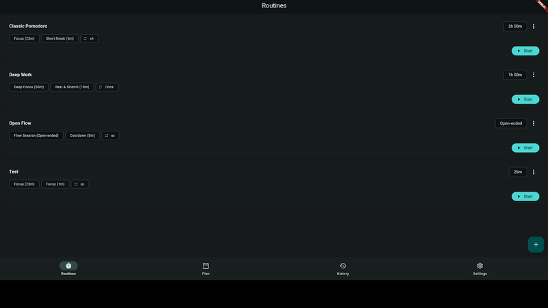

<p align="center">
  
</p>

<h1 align="center">Diti</h1>

<p align="center">
  <strong>Focus on what matters. Adapt when reality changes.</strong><br>
  Cross-platform, 100% local-first daily planning and multi-phase routine timer built with Flutter.
</p>

<p align="center">
  <a href="https://github.com/Adamskiee/diti/actions/workflows/ci.yml"></a>
  <a href="https://github.com/Adamskiee/diti/actions/workflows/security.yml"></a>
  <a href="https://github.com/Adamskiee/diti/releases/latest"></a>
  
  
  =3.27.0" />
</p>

---

## 🚀 Download & Install

Get Diti running on your device in seconds:

### 📱 Android
Download the latest binaries directly from [**GitHub Releases**](https://github.com/Adamskiee/diti/releases/latest):

- [**Universal APK**](https://github.com/Adamskiee/diti/releases/latest) — Compatible with all Android phones and tablets
- [**ARM64-v8a APK**](https://github.com/Adamskiee/diti/releases/latest) — Optimized for modern 64-bit Android devices
- [**App Bundle (.aab)**](https://github.com/Adamskiee/diti/releases/latest) — Play Store bundle format

### 🐧 Linux Desktop
Install and configure Diti with a single non-root command:

```bash
# Direct installer (downloads and configures desktop entry & updater):
curl -fsSL https://raw.githubusercontent.com/Adamskiee/diti/main/scripts/install-linux.sh | bash

# Or build and install from a local checkout:
./scripts/install-linux.sh --local
```

This sets up:
- **Executable:** `~/.local/bin/diti`
- **Desktop Launcher:** Application menu icon in `~/.local/share/applications/diti.desktop`
- **One-Command Updater:** Run `diti --update` (or `diti-update`) whenever a new release is published.
- **Standalone Binaries:** Portable `.AppImage` and `.tar.gz` are also available on [**Releases**](https://github.com/Adamskiee/diti/releases/latest).

---

## ✨ Why Diti?

Most timer applications assume your day goes exactly according to plan. Diti is built for real life—giving you structure while flexing when interruptions happen.

| Feature | What It Does | Why You'll Love It |
|---|---|---|
| ⏱️ **Multi-Phase Routines** | Chain custom work, deep focus, and rest phases with configurable durations and auto-advance. | Go beyond rigid Pomodoro timers. Tailor intervals to your actual flow state. |
| ⏳ **Negative Overtime Tracking** | When a rest interval finishes, Diti counts into negative time until you continue. | Never wonder how much extra break time you took. Keeps you accountable without rigid alarms. |
| 📅 **Plan vs. Reality Blocking** | Schedule routines across your daily agenda and compare intended duration against actual tracked time. | See where your time really went and calibrate realistic daily expectations. |
| 🔄 **Manual Session Recovery** | Log sessions manually or retroactively recover untracked focus time directly from Plan and History. | Never lose credit for completed work if you forgot to start the timer. |
| 🔒 **100% Local-First & Private** | All routines, plans, and session records live in a local SQLite database (`~/Documents/diti.db`). | Zero accounts, zero cloud dependencies, zero telemetry. Your data stays yours forever. |
| 🛡️ **Crash-Proof State Engine** | Timer state snapshots survive app restarts, task kills, backgrounding, and system reboots. | Closing your laptop or swiping the app away will never destroy an active session. |
| 📊 **Productivity Analytics** | Responsive breakdown of completed sessions, phase distribution, and day-by-day focus habits. | Gain clear insights into focus trends across mobile and desktop displays. |

---

## 🎬 See It in Action

<p align="center">
  
</p>

---

## 🤝 Contributing

**Everyone is welcome to contribute to Diti!** 

Whether you want to build a new feature, fix a bug, polish the UI, improve the documentation, or share feedback on your daily routine workflow, we'd love to have you.

- 📖 **New Contributors:** Please see our [**Contributing Guide (CONTRIBUTING.md)**](CONTRIBUTING.md) for step-by-step development setup, architectural walkthrough, and testing workflows.
- 💬 **Discussions & Issues:** Have a suggestion or found an issue? Open a [GitHub Issue](https://github.com/Adamskiee/diti/issues).

---

## 🛠️ Quick Developer Overview

For full instructions, read [**CONTRIBUTING.md**](CONTRIBUTING.md).

```bash
# Clone the repository
git clone https://github.com/Adamskiee/diti.git
cd diti

# Install dependencies across all modular packages
for pkg in packages/*; do
  if [ -f "$pkg/pubspec.yaml" ]; then
    (cd "$pkg" && flutter pub get)
  fi
done
flutter pub get

# Run test suite & static analysis
CI=true flutter test test/
flutter analyze --fatal-infos
```

---

## 🔒 Security & Quality Assurance

Diti enforces automated continuous integration and multi-layer security auditing on every change:
- **Continuous Integration (`ci.yml`)**: Fast PR checks for unit, widget, golden, and Linux desktop integration tests.
- **Security CI (`security.yml`)**: Secret scanning (`gitleaks`), dependency vulnerability audits (`trivy`), Android APK hardening checks (`MobSF`), and OWASP MASVS v2 mapping. See the [MASVS Coverage Matrix](docs/security/masvs-coverage.md) for compliance details.
- **Pre-Release Verification (`release.yml`)**: Android Patrol E2E tests, obfuscation verification, and strict release signing.

---

## 📄 License

Diti is open-source software. All routines, user databases, and session histories remain 100% private and stored locally on your device.
